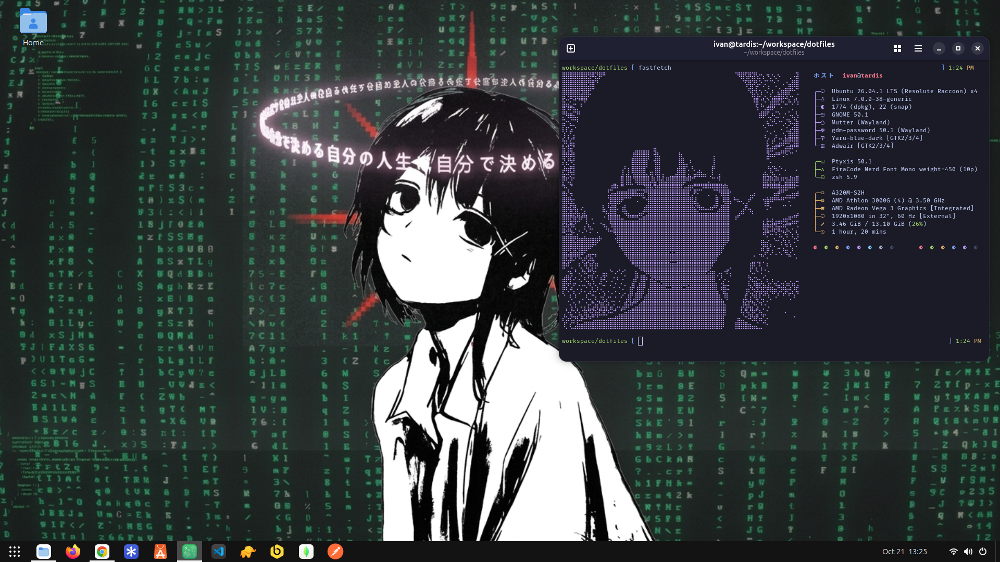

# 🌐 Dotfiles

My personal Linux desktop configuration, including Fastfetch customization, terminal fonts, ASCII logos, wallpapers, and profile pictures.




## 📑 Table of Contents

- [Environment](#-environment)
- [Repository Structure](#-repository-structure)
- [Installation Guide](#-installation-guide)
  - [Install Nerd Fonts Symbols](#1-install-nerd-fonts-symbols)
  - [Install FiraCode Nerd Font](#2-install-firacode-nerd-font)
  - [Install Fastfetch](#3-install-and-configure-fastfetch)
  - [Configure the ASCII Logo](#4-configure-the-ascii-logo)
- [Desktop Customization](#-desktop-customization)
  - [Icon Theme](#-icon-theme)
  - [GNOME Extensions](#-gnome-extensions)
  - [Wallpapers](#-wallpapers)
- [License](#-license)

## 🖥️ Environment

| Component | Configuration |
|---|---|
| **Operating System** | Ubuntu |
| **Terminal Emulator** | Ptyxis / GNOME Terminal |
| **Shell** | Zsh |
| **System Information Tool** | [Fastfetch](https://github.com/fastfetch-cli/fastfetch) |
| **Font** | FiraCode Nerd Font |

## 📁 Repository Structure

```text
└── dotfiles/
    ├── assets/
    │   ├── wallpapers/
    │   │   ├── Anime/
    │   │   │   └── wall-1.png
    │   │   └── Lain/
    │   │       └── wall-2.png
    │   ├── profile-pics/
    │   │   └── pic-1.png
    │   └── ascii-logos/
    │       └── logo-1.txt
    └── fastfetch/
        └── config.jsonc

```

## 🚀 Installation Guide

These instructions assume you are using Ubuntu and have Git, `wget`, and `unzip` available.

### 1. Install Nerd Fonts Symbols

Nerd Fonts Symbols provides additional glyphs and icons used by terminal applications and Fastfetch.

```bash
mkdir -p ~/.local/share/fonts/nerd-symbols
cd ~/.local/share/fonts/nerd-symbols

wget https://github.com/ryanoasis/nerd-fonts/releases/latest/download/NerdFontsSymbolsOnly.zip

unzip NerdFontsSymbolsOnly.zip
rm NerdFontsSymbolsOnly.zip

fc-cache -f
```

### 2. Install FiraCode Nerd Font

FiraCode Nerd Font provides programming ligatures and additional glyphs for terminal applications.

```bash
mkdir -p ~/.local/share/fonts/firacode-nerd
cd ~/.local/share/fonts/firacode-nerd

wget https://github.com/ryanoasis/nerd-fonts/releases/latest/download/FiraCode.zip

unzip FiraCode.zip
rm FiraCode.zip

fc-cache -f
```

After installation, open your terminal preferences and select **FiraCode Nerd Font** as the terminal font.

### 3. Install and Configure Fastfetch

Update your package lists and install Fastfetch:

```bash
sudo apt update
sudo apt install fastfetch
```

If the package is unavailable in your Ubuntu repositories, follow the installation instructions in the [official Fastfetch repository](https://github.com/fastfetch-cli/fastfetch).

Generate the default configuration directory and file:

```bash
fastfetch --gen-config
```

From the root directory of this repository, copy the custom configuration:

```bash
mkdir -p ~/.config/fastfetch
cp ./fastfetch/config.jsonc ~/.config/fastfetch/config.jsonc
```

Run Fastfetch to verify the configuration:

```bash
fastfetch
```

### 4. Configure the ASCII Logo

Open the Fastfetch configuration file:

```bash
nano ~/.config/fastfetch/config.jsonc
```

Locate the logo configuration and update its `source` value to point to the ASCII logo you want to use.

For example:

```jsonc
"source": "/home/YOUR_USERNAME/path/to/dotfiles/assets/ascii-logos/lain-1.txt"
```

Replace the example path with the actual absolute path to your chosen logo file.

Save the file and run Fastfetch again:

```bash
fastfetch
```


## 🎨 Desktop Customization

This section documents the themes, extensions, and visual assets used in my desktop environment.


### 🎨 Icon Theme

- **Name:** Colloid icon theme
- **Source:** [Official Download Page](https://github.com/vinceliuice/Colloid-icon-theme)
- **Installation:** Install the theme and select it using GNOME Tweaks.

### 🧩 GNOME Extensions

| Extension | Description | Source |
|---|---|---|
| Dash to Panel | An icon taskbar for the Gnome Shell. | [GNOME Extensions](https://extensions.gnome.org/extension/1160/dash-to-panel/) |


### 🖼️ Wallpapers

My wallpapers are stored in `assets/wallpapers/`.

- **Preview:** [Wallpaper Source](./assets/wallpapers/Anime/wall-14.jpg)
- **Credits:** Original authors are credited whenever applicable.


## ⚙️ Customization

You can personalize this setup by modifying the following resources:

- **Wallpapers:** Store your preferred desktop backgrounds in `assets/wallpapers/`.
- **Profile Pictures:** Keep your custom profile images in `assets/profile-pics/`.
- **ASCII Logos:** Add your own ASCII artwork to `assets/ascii-logos/` and update the Fastfetch configuration accordingly.
- **Fastfetch:** Edit `fastfetch/config.jsonc` to customize the displayed system information and logo.

## 📝 Notes

- These dotfiles are designed for my personal Ubuntu environment.
- Some paths and settings may need to be adjusted when using a different username or directory structure.
- Back up existing configuration files before replacing them.

## 📄 License

Feel free to explore and adapt this configuration for your own Linux setup.


